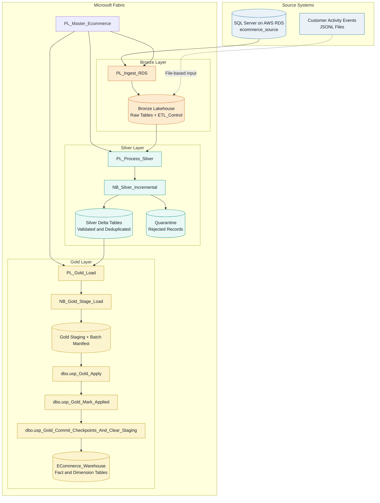

# E-Commerce Data Engineering & Analytics Platform

An end-to-end batch data engineering portfolio project built around an Indian e-commerce source system and a Microsoft Fabric Bronze, Silver, and Gold architecture.

The project demonstrates relational source-data generation, incremental ingestion, PySpark transformations, data-quality checks, controlled Gold loading, checkpoint management, and dimensional modeling for analytical consumption.

**Project status:** In progress  
**Validated batches:** 7, 9, and 10  
**Batch 8:** Recovered from an initial source/ingestion issue; event data subsequently reconciled  
**Next milestone:** Batch 11 execution and validation

> **Implementation note:** The SQL Server source schema and Python data-generator code are maintained in this repository. The Fabric pipelines, notebooks, Lakehouse objects, Warehouse objects, and stored procedures currently exist in the Fabric workspace and are not included here as deployable exports.

## 1. Business Problem

E-commerce operational systems maintain data across customers, products, sellers, locations, orders, order items, payments, and customer activity events.

Raw operational data is not immediately suitable for reliable analytics. It can contain duplicates, invalid relationships, late-arriving changes, rejected records, and updates to existing entities.

This project demonstrates a batch-oriented data platform that ingests operational data, validates and transforms it, maintains processing checkpoints, and produces curated fact and dimension tables for downstream analytics.

## 2. Architecture

### High-level data flow

The platform follows a layered batch-processing architecture. Operational data is ingested into Bronze, validated and transformed in Silver, and promoted through a controlled staging-and-commit workflow into the Gold Warehouse.


### High-level data flow




**Processing principles**

- **Incremental ingestion:** Bronze ingestion uses configured load types and watermark control state.
- **Data quality:** Silver applies validation, deduplication, and quarantine handling before promoting accepted records.
- **Controlled Gold loading:** Data passes through staging, apply, and commit steps, with batch manifests and checkpoints supporting controlled processing and recovery.
- **Analytics-ready output:** The Fabric Warehouse contains curated fact and dimension tables for downstream analytical consumption.

*Note: Customer activity events are generated as JSON Lines files separately from the relational SQL Server tables. The diagram represents their logical ingestion into the platform; configure the actual pipeline activities and file paths according to the Fabric workspace implementation.*

### Processing flow

1. **Source system:** SQL Server on AWS RDS stores the operational e-commerce entities.
2. **Ingestion:** Fabric Data Factory pipelines ingest source records into the Bronze Lakehouse.
3. **Bronze:** Raw ingested data is retained for downstream processing. `dbo.ETL_Control` tracks load configuration, watermark state, run IDs, statuses, and timestamps.
4. **Silver:** PySpark transformations perform data-quality checks, deduplication, quarantine handling, and incremental merges.
5. **Gold staging:** The Gold notebook prepares data for controlled application to the Warehouse.
6. **Gold application:** Stored procedures coordinate application, batch-state transitions, checkpoint advancement, and staging cleanup.
7. **Analytics:** The Fabric Warehouse contains fact and dimension tables designed for analytical queries and reporting.

Customer activity events are generated separately as JSON Lines files. They are not a ninth operational table in the checked-in SQL Server source schema.

## 3. Technology Stack

| Area | Technology |
|---|---|
| Operational source | SQL Server on AWS RDS |
| Source-data generation | Python |
| Database connectivity | pyodbc, Microsoft ODBC Driver 18 |
| Configuration | Environment variables and python-dotenv |
| Orchestration | Microsoft Fabric Data Factory pipelines |
| Data lake | OneLake and Fabric Lakehouse |
| Processing | PySpark notebooks |
| Storage format | Delta tables |
| Data warehouse | Microsoft Fabric Warehouse |
| Transformation layers | Bronze, Silver, Gold |
| Data modeling | Dimensional modeling, fact and dimension tables |
| Version control | Git |
| Reporting direction | Semantic model and Power BI |

## 4. Source Data

The checked-in source schema is maintained at `source-system/sql/source_schema.sql`.

It defines eight operational tables:

| Table | Purpose |
|---|---|
| `locations` | Location and region reference data |
| `customers` | Customer profile and status |
| `sellers` | Seller profile and status |
| `categories` | Product category reference data |
| `products` | Product catalog and category relationships |
| `orders` | Order headers, status, locations, and amounts |
| `order_items` | Products, sellers, quantities, and amounts per order line |
| `payments` | Payment details, amounts, and transaction status |

The Python data generator creates synthetic data for these entities and supports initial data generation and incremental batch generation/application.

Customer activity events are generated separately as JSON Lines data.

## 5. Data Processing Design

### Bronze layer

The Bronze Lakehouse stores ingested source data and maintains ingestion-control information.

`dbo.ETL_Control` records the configured source and target objects, load type, watermark column, last successful watermark, run ID, run status, and run timestamp.

The ingestion design supports watermark-based incremental extraction for configured tables and full loading for selected reference data.

### Silver layer

The Silver processing workflow uses `PL_Process_Silver` and `NB_Silver_Incremental`.

The processing design includes:

- Data-quality checks before accepted records are promoted.
- Deduplication and incremental merge processing.
- Referential-integrity checks for related entities.
- Rejection and quarantine handling for invalid records.
- Processing of updates to existing entities.
- Incremental processing of customer activity events.

Rejected records should be investigated using the relevant source data, processing rules, and quarantine evidence rather than being discarded without explanation.

### Gold layer

The Gold workflow is orchestrated by `PL_Gold_Load` and uses the following activities in sequence:

1. `NB_Gold_Stage_Load`
2. `dbo.usp_Gold_Apply`
3. `dbo.usp_Gold_Mark_Applied`
4. `dbo.usp_Gold_Commit_Checkpoints_And_Clear_Staging`

The Gold batch manifest records the `STAGED`, `APPLIED`, and `COMMITTED` states. `dbo.Gold_ETL_Control` maintains Gold processing checkpoints.

The staged workflow separates data preparation from application and checkpoint commitment. Recovery after a failure must consider the recorded manifest state, checkpoints, and staging contents. A complete pipeline rerun should not be assumed safe after every partial failure.

## 6. Analytical Data Model

The Gold Warehouse is named `ECommerce_Warehouse`.

The documented analytical tables include:

| Table | Type | Purpose |
|---|---|---|
| `DimRegion` | Dimension | Region-level analysis |
| `DimCategory` | Dimension | Product category analysis |
| `DimSeller` | Dimension | Seller analysis |
| `DimProduct` | Dimension | Product analysis |
| `DimCustomer` | Dimension | Customer analysis |
| `FactSales` | Fact | Sales and order-item analysis |
| `FactPayment` | Fact | Payment analysis |
| `FactCustomerEvent` | Fact | Customer activity analysis |

The Warehouse DDL and a complete dimensional-model diagram are not currently included in this repository.

## 7. Incremental Processing and Recovery

The project uses separate mechanisms for source-data generation, ingestion, Silver processing, and Gold checkpoint management.

### Python data generation

The initial-data and incremental-data scripts generate synthetic source data. Incremental generation discovers source state at runtime and creates batch output under `data_generator/output/`.

Generating a batch and applying a batch to the source database are separate operations. Database-writing scripts must be reviewed against the intended database before execution.

### Fabric ingestion

The ingestion pipeline uses configured load types and watermark boundaries to identify eligible source records. The ingestion control state is distinct from the Gold Warehouse checkpoints.

### Gold processing

Gold staging and batch-manifest states provide visibility into the stage, application, and commit phases. Following a failure, inspect the recorded batch state before deciding which operation to retry.

The current implementation is project-specific; this README does not claim that every possible failure scenario has been tested.

## 8. Data Quality, Validation, and Monitoring

Validation is performed at multiple points in the workflow.

### Source-data validation

The Python repository includes validation modules for initial data, orders, payments, customer events, and related configuration.

### Silver validation

Silver processing applies quality rules before merging accepted records. Invalid or rejected records can be separated into quarantine for investigation.

### Gold validation

Project validation has included checks such as:

- Fact-table duplicate-key checks.
- Referential-integrity checks for selected fact-to-dimension relationships.
- Validation of customer current-row behavior.
- Reconciliation of relevant source, Silver, and Gold record counts.
- Gold checkpoint advancement and batch status.
- Staging cleanup after a successful commit.

The project has also used manifest and checkpoint state to investigate processing issues. The repository does not currently contain a complete monitoring dashboard, alert configuration, or an independently reproducible validation-results package.

## 9. Project Progress

| Batch | Status | Notes |
|---|---|---|
| 7 | Validated | Gold tables, keys, selected relationships, checkpoints, and staging cleanup checked |
| 8 | Recovered and reconciled | Initial source/ingestion issue investigated and event data reconciled |
| 9 | Validated | Ingestion issue investigated and corrected before downstream processing |
| 10 | Validated | Data loaded through the pipeline and validation passed |
| 11 | Planned | Next batch execution and validation |

**Overall project status: In progress.**

These are recorded project progress notes, not test results produced by the README itself.

## 10. Repository Structure

```text
ecommerce-india-fabric-platform/
├── README.md
├── AGENTS.md
├── .env.example
├── .gitignore
├── requirements.txt
├── source-system/
│   └── sql/
│       └── source_schema.sql
└── data_generator/
    ├── __init__.py
    ├── config/
    │   ├── __init__.py
    │   ├── customer_config.py
    │   ├── customer_event_config.py
    │   ├── order_config.py
    │   ├── payment_config.py
    │   ├── product_catalog.py
    │   ├── product_models.py
    │   ├── product_variants.py
    │   ├── seller_config.py
    │   └── settings.py
    ├── database/
    │   ├── __init__.py
    │   ├── bulk_insert.py
    │   └── connection.py
    ├── generators/
    │   ├── __init__.py
    │   ├── categories.py
    │   ├── customer_events.py
    │   ├── customers.py
    │   ├── locations.py
    │   ├── order_financials.py
    │   ├── order_items.py
    │   ├── orders.py
    │   ├── payments.py
    │   ├── products.py
    │   ├── seller_product_mapping.py
    │   └── sellers.py
    ├── reference-data/
    │   ├── india_location_source.csv
    │   ├── india_locations.csv
    │   └── state_region_mapping.csv
    ├── scripts/
    │   ├── __init__.py
    │   ├── apply_incremental_data.py
    │   ├── generate_incremental_data.py
    │   ├── generate_initial_data.py
    │   ├── load_source_to_rds.py
    │   ├── prepare_locations.py
    │   ├── validate_customer_event_files.py
    │   ├── validate_customers.py
    │   ├── validate_products.py
    │   ├── validate_sellers.py
    │   ├── validate_product_catalog.py
    │   ├── validate_product_models.py
    │   ├── validate_product_variants.py
    │   └── write_customer_events_json.py
    └── validation/
        ├── __init__.py
        ├── validate_customer_event_config.py
        ├── validate_customer_events.py
        ├── validate_initial_data.py
        ├── validate_orders.py
        ├── validate_payment_config.py
        └── validate_payments.py
```

Generated data under `data_generator/output/` is excluded from version control. The tree describes the intended tracked source files; check the current repository if any listed files have changed.

## 11. Local Setup

### Prerequisites

- Python 3.11 or another version compatible with the project dependencies.
- Microsoft ODBC Driver 18 for SQL Server.
- Access to an authorized SQL Server instance.
- Git and PowerShell.

### Create the environment

Run these commands from the repository root:

```powershell
python -m venv .venv
.\.venv\Scripts\Activate.ps1
python -m pip install -r requirements.txt
Copy-Item .env.example .env
```

Edit `.env` with your own database connection settings:

```text
DB_SERVER=your-sql-server-host
DB_PORT=1433
DB_NAME=ecommerce_source
DB_USER=your_username
DB_PASSWORD=your_password
```

The values above are placeholders. Do not commit the real `.env` file, passwords, cloud access keys, or connection strings containing credentials.

### Generate initial data

```powershell
python -m data_generator.scripts.generate_initial_data
```

Review the script and its output to understand the generated snapshot and validation behavior before performing any database load.

### Generate incremental batch data

```powershell
python -m data_generator.scripts.generate_incremental_data
```

Incremental generation uses the configured source connection to discover source state and writes generated batch files. Review the generated output before applying a batch.

### Apply or load data

The repository also includes database-writing scripts:

- `data_generator.scripts.apply_incremental_data`
- `data_generator.scripts.load_source_to_rds`

These operations can modify the configured database. Review the code, arguments, target environment, and batch output before running them. They are intentionally not presented as automatic setup steps.

This repository does not currently provide a command to provision or deploy the Fabric workspace.

## 12. Security Considerations

- Database connection values are read from environment variables.
- `.env` is excluded from version control.
- `.env.example` contains placeholders only.
- Generated data files are excluded from version control.
- Database-writing scripts must be executed only against an intended environment.
- Screenshots, logs, and documentation should be checked for credentials and private endpoint details before publication.

## 13. Limitations and Remaining Work

The following items remain part of the portfolio completion effort:

- Execute and validate Batch 11.
- Add a reviewed architecture image and dimensional-model diagram.
- Include sanitized screenshots of the actual Fabric pipelines, Lakehouse, Warehouse, and run history.
- Publish representative Bronze, Silver, and Gold validation evidence.
- Document important pipeline parameters, watermark boundaries, failure handling, and recovery steps.
- Evaluate a controlled failure-and-recovery scenario.
- Review schema-change behavior and document the observed result.
- Review security and configuration for public publication.
- Add Fabric pipeline/notebook exports where practical and safe.
- Prepare a reproducible portfolio walkthrough and interview explanations.

## 14. Disclaimer

This project uses synthetic e-commerce data for educational and portfolio purposes. Cloud resources, database access, and Fabric workspace artifacts require separate configuration and are not automatically provisioned by the Python repository.
