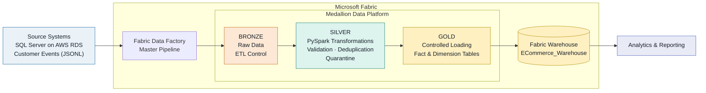
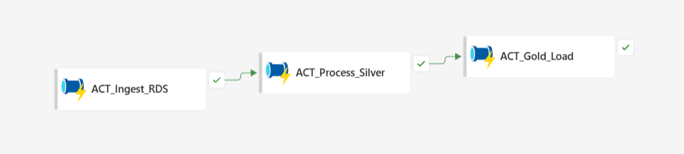
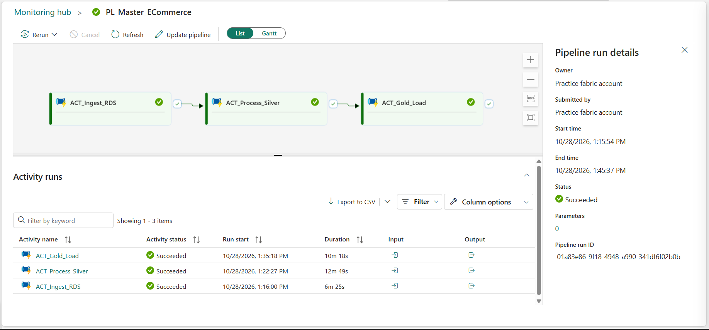

# E-Commerce Data Engineering & Analytics Platform

An end-to-end batch data engineering project built with **Microsoft Fabric, PySpark, OneLake, and SQL Server on AWS RDS**.

The platform ingests synthetic e-commerce data, applies incremental processing and data-quality rules, and produces analytics-ready fact and dimension tables.

## Business Problem

E-commerce operational systems maintain customer, product, seller, order, payment, and customer-activity data across different sources. Raw data requires validation, deduplication, relationship checks, and incremental processing before it can support reliable analytics.

This project demonstrates a layered data engineering platform that transforms operational data into curated analytical tables using Microsoft Fabric.

## Architecture



## Key Engineering Features

- **Incremental ingestion:** Watermark-based extraction and ingestion-control tracking.
- **Data quality:** Validation, deduplication, referential-integrity checks, and quarantine handling.
- **Controlled Gold processing:** Staging, batch manifests, checkpoints, and commit workflow.
- **Dimensional modeling:** Fact and dimension tables for analytical queries.
- **Synthetic source data:** Python-based initial and incremental data generation.

## Technology Stack

| Area | Technologies |
|---|---|
| Operational source | SQL Server on AWS RDS |
| Orchestration | Microsoft Fabric Data Factory |
| Storage | OneLake, Fabric Lakehouse, Delta tables |
| Transformation | PySpark notebooks |
| Data warehouse | Microsoft Fabric Warehouse |
| Data modeling | Dimensional modeling |
| Data generation | Python |
| Version control | Git, GitHub |

## Analytical Data Model

The Gold Warehouse, `ECommerce_Warehouse`, contains:

| Dimensions | Fact tables |
|---|---|
| `DimRegion` | `FactSales` |
| `DimCategory` | `FactPayment` |
| `DimSeller` | `FactCustomerEvent` |
| `DimProduct` | |
| `DimCustomer` | |

The model supports analysis of sales, payments, customers, products, sellers, and customer activity.

## Pipeline Execution Evidence

### Master Pipeline



### Successful Pipeline Execution



The screenshots show the master pipeline orchestration and a successful execution of the ingestion, Silver processing, and Gold loading stages.

## Repository Structure

```text
ecommerce-india-fabric-platform/
├── README.md
├── AGENTS.md
├── .env.example
├── .gitignore
├── requirements.txt
├── source-system/
│   └── sql/
│       └── source_schema.sql
├── data_generator/
│   ├── config/
│   ├── database/
│   ├── generators/
│   ├── reference-data/
│   ├── scripts/
│   └── validation/
└── docs/
    ├── architecture/
    └── screenshots/
        ├── master-pipeline.png
        └── master-pipeline-run-history.png
```

The repository contains the source schema, Python data-generation and validation code, configuration examples, and documentation. Fabric pipelines, notebooks, Lakehouse objects, Warehouse objects, and stored procedures currently reside in the Fabric workspace and are not included as deployable exports.

## Local Setup

### Prerequisites

- Python 3.11 or another version compatible with the project dependencies
- Microsoft ODBC Driver 18 for SQL Server
- Access to an authorized SQL Server instance
- Git and PowerShell

### 1. Set up the environment

Run these commands from the repository root:

```powershell
python -m venv .venv
.venv\Scripts\Activate.ps1
python -m pip install -r requirements.txt
Copy-Item .env.example .env
```

### 2. Configure the database connection

Update `.env` with your authorized SQL Server connection details. Use the variable names and format defined in `.env.example`.

Never commit `.env`, passwords, access keys, or connection strings containing credentials.

### 3. Generate initial data

```powershell
python -m data_generator.scripts.generate_initial_data
```

### 4. Generate incremental data

```powershell
python -m data_generator.scripts.generate_incremental_data
```

Review generated output and the database-writing scripts before applying data to a database. Initial generation, incremental generation, and applying a batch are separate operations.

**Note:** The repository does not automatically provision the AWS database or deploy the Microsoft Fabric workspace. Those resources require separate configuration.

## Security

- Database credentials are supplied through environment variables.
- `.env` is excluded from version control; `.env.example` provides the configuration template.
- Generated output is excluded from version control.
- Database-writing scripts should be reviewed before execution.
- Screenshots and documentation should not expose credentials or private connection details.

## Disclaimer

This project uses synthetic e-commerce data for educational and portfolio purposes. Cloud resources and Fabric workspace artifacts require separate configuration.